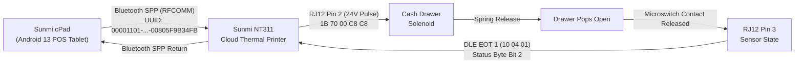

# Sunmi Cloud Printer & Cash Drawer SDK - Complete Reference & Controller

**Official References**:
* [Sunmi Cloud Printer Documentation](https://docs.sunmi.com/en-US/cdixeghjk491/xffzeghjk557)
* [Sunmi Cash Drawer Control API](https://docs.sunmi.com/en-US/cdixeghjk491/xfxdeghjk524)
* Official Sunmi SDK: `com.sunmi.externalprinterlibrary2` (`EscUtil`, `TransTask`, `StatusTask`)

This repository provides an enterprise-grade, production-ready solution for **Cash Drawer control, real-time status detection, audit logging, and reporting** connecting the **Sunmi cPad (Android 13 POS)** to the **Sunmi NT311 Cloud Printer** via **Bluetooth (SPP)**, **Wi-Fi / Ethernet LAN (RAW TCP Socket port 9100)**, and **Sunmi Cloud OpenAPI**.

---

## Table of Contents
1. [Key Features](#key-features)
2. [Hardware Architecture & RJ12 Wiring](#hardware-architecture--rj12-wiring)
3. [Microswitch Polarity: Normally Closed (N.C.) vs Normally Open (N.O.)](#microswitch-polarity-normally-closed-nc-vs-normally-open-no)
4. [Connection Modes (Bluetooth & Wi-Fi/LAN)](#connection-modes-bluetooth--wifilan)
5. [Official ESC/POS Command Bytecodes](#official-escpos-command-bytecodes)
6. [Official Sunmi Cash Drawer API Implementation](#official-sunmi-cash-drawer-api-implementation)
7. [Cash Drawer Logs & Audit Report Feature](#cash-drawer-logs--audit-report-feature)
8. [Sunmi Cloud OpenAPI & Webhooks](#sunmi-cloud-openapi--webhooks)
9. [Production APK Build & Installation (Android 13)](#production-apk-build--installation-android-13)
10. [Repository Structure](#repository-structure)

---

## Key Features

1. **Triple Connection Modes**:
   * **Wi-Fi / Ethernet LAN (Port 9100 RAW ESC/POS)**: High-speed TCP socket interface connecting directly across the local LAN/WLAN. Includes built-in multi-threaded Subnet Scanner with discovery for Sunmi default IPs (`192.168.103.134`, etc.) and sub-millisecond status polling (`setTcpNoDelay`).
   * **Bluetooth SPP (Wireless RFCOMM)**: Direct RFCOMM connection from Sunmi cPad to Sunmi NT311 for instant offline transaction kicking, continuous background status polling (`10 04 01`), and automatic status back (ASB `1D 61 01`).
   * **Sunmi Cloud OpenAPI**: Cloud-driven solenoid kicks, device status queries, and signed HMAC-SHA256 webhook event callbacks on port `8080`.
2. **Enhanced Real-Time Status Detection & Polarity Auto-Calibration**:
   * Pre-configured for commercial POS cash drawers using **Normally Closed (N.C.)** microswitches where **Bit 2 = 0 is OPEN** and **Bit 2 = 1 is CLOSED**.
   * **Self-Learning Auto-Calibration**: When a solenoid kick is issued, the driver samples pre- and post-kick states. If Bit 2 transitioned from 0 -> 1 rather than 1 -> 0, polarity auto-adjusts immediately.
   * **Multi-Packet Framing & Debouncing**: Stream ring-buffer handles 1-byte real-time packets (`0x12`, `0x16`), 4-byte ASB frames (`0x37 0x09`), and custom queries with a 60ms temporal debouncer preventing false triggers from mechanical switch bounce.
   * One-tap **Polarity Toggle Button** on the dashboard to switch dynamically between Inverted (N.C.) and Normal (N.O.) modes without restarting.
3. **Official Sunmi `externalprinterlibrary2` Bytecode Alignment**:
   * Matches Sunmi's official `EscUtil.openCash()` (`1B 70 00 C8 C8`), `REAL_TIME` status (`10 04 01`), `customQueryStatus` (`1D 28 54 01 00 01`), and 4-byte `0x37 0x09` packet decoding.
4. **Interactive Android Controller & Hardware Visualizer**:
   * Animated sliding cash drawer with compartment dividers.
   * Real-time RJ12 Pin 2 (Solenoid Drive) and Pin 3 (Microswitch Sensor) telemetry badges.
   * 30-Second Unclosed Overtime Watchdog Alarm with haptic vibration and visual warning banner.
5. **Cash Drawer Audit & Logs Report**:
   * Computes Total Opens, Solenoid Kicks, Cloud Kicks, Manual Key Opens, Total Closes, Average Open Duration, Max Open Duration, and Security Alerts.
   * **Direct ESC/POS Thermal Printing** to Sunmi NT311.
   * Android System Share Sheet export (`Intent.ACTION_SEND`), Clipboard copy, and CSV export.
6. **Production-Ready Android 13 APK**:
   * Native Android 13 (`targetSdk 33`, `minSdk 21`) compilation.
   * Signed with `production.keystore` supporting **v1 (JAR), v2, and v3** signature schemes.

---

## Hardware Architecture & RJ12 Wiring

The Sunmi NT311 printer connects to the physical cash drawer using a standard **RJ12 (6P6C)** interface:

```
           RJ12 6-Pin Interface (Female Port on NT311)
         ┌───────────────────────────────────────────┐
         │     1     2     3     4     5     6       │
         └─────┬─────┬─────┬─────┬─────┬─────┬───────┘
               │     │     │     │     │     │
 Pin 1: Frame GND / Shield
 Pin 2: Drawer 1 Solenoid Drive Pulse (-) [Open Drawer Kick]
 Pin 3: Drawer Microswitch Sensor Signal [Status Detection]
 Pin 4: +24V DC Solenoid Power Supply
 Pin 5: Drawer 2 Solenoid Drive Pulse (-) [Optional secondary drawer]
 Pin 6: Signal Ground (GND)
```



---

## Microswitch Polarity: Normally Closed (N.C.) vs Normally Open (N.O.)

Standard commercial POS cash drawers utilize a mechanical microswitch inside the drawer chassis attached to RJ12 Pin 3:

| Circuit Type | Physical State | Pin 3 Voltage | ESC/POS Bit 2 | Driver Interpretation |
| :--- | :--- | :--- | :--- | :--- |
| **Normally Closed (N.C.)** *(Industry Standard)* | **Drawer Closed** | Compressed (HIGH) | `1` | **CLOSED (SECURED)** |
| **Normally Closed (N.C.)** *(Industry Standard)* | **Drawer Open** | Released (LOW) | `0` | **OPEN (IN TRANSACTION)** |
| **Normally Open (N.O.)** | **Drawer Closed** | Released (LOW) | `0` | **CLOSED (SECURED)** |
| **Normally Open (N.O.)** | **Drawer Open** | Compressed (HIGH) | `1` | **OPEN (IN TRANSACTION)** |

### Why Did the Drawer Previously Show Open when Closed?
Printers return the raw microswitch voltage level on Bit 2. For an N.C. drawer, closing the drawer keeps Pin 3 pulled HIGH (`Bit 2 = 1`). A naive driver expecting N.O. would report `1` as open. 

### Solution in this SDK:
1. **Inverted Polarity Enabled by Default** in `SunmiBluetoothManager.java`:
   ```java
   int bit2 = (statusByte >> 2) & 0x01;
   final boolean isOpen = invertPolarity ? (bit2 == 0) : (bit2 == 1);
   ```
2. **On-the-Fly Polarity Button**:
   * Green Button: `🔄 Polarity: INVERTED (N.C. 0=Open, 1=Closed)`
   * Blue Button: `🔄 Polarity: NORMAL (N.O. 1=Open, 0=Closed)`
   * Tapping the button switches modes immediately without reconnecting.

---

## Connection Modes (Bluetooth & Wi-Fi/LAN)

### 1. Wi-Fi / Ethernet LAN Mode (Connecting from SunmiPrinter Setup)
* **Protocol**: Direct TCP Socket over local network to RAW ESC/POS port **9100**.
* **Connect from Added Printers in SunmiPrinter Setup**:
  * Tap **`🌐 Wi-Fi / LAN`** on the app action bar to open the network connection manager.
  * The dialog directly surfaces printers configured in **SunmiPrinter Setup** (`sunmi-cloud-printer-setup.exe` / `SunmiPrinter` mobile app) displaying:
    * **Model** (e.g. `NT311`, `NT312`, `NT211`)
    * **Serial Number (SN)** (e.g. `N402D05T00007`)
    * **Target IP & Port** (e.g. `192.168.103.134:9100`)
    * **Connection Type** (`Ethernet` or `Wi-Fi`)
  * **1-Tap Instant Connect**: Tapping any saved printer automatically sets the IP/Port, updates the device serial number in `SunmiCloudPrinter.DEFAULT_SN`, and opens the high-speed TCP socket immediately.
  * **Add / Register from Setup**: Tap **`➕ Add from Setup`** to save your custom printer's Model, SN, IP, and Port permanently in Android `SharedPreferences`.
* **Network IP Discovery & Subnet Scanner**:
  * Displays the current Sunmi cPad IP and active subnet (e.g. `cPad IP: 192.168.1.45 (Subnet: 192.168.1.x)`).
  * Multi-threaded scanner (`SunmiLanScanner.java`) checks all 254 subnet hosts and Sunmi default IPs concurrently across 28 threads.
  * Discovered devices can be selected with one tap.
* **Network Socket Tuning**:
  * `setTcpNoDelay(true)`: Disables Nagle's algorithm to eliminate latency on real-time polling packets (`10 04 01`).
  * `setKeepAlive(true)`: Sustains socket health during extended POS counter idle periods.
  * All socket writes execute on a dedicated background I/O worker (`ioExecutor`), guaranteeing zero UI blocking and full immunity to `NetworkOnMainThreadException`.
* **Obtaining Sunmi Printer IP (Setup Guide v1.3)**:
  * **Self-Test Ticket**: Turn off printer. Press and hold the **FEED** button while powering on until the status light flashes, then release. The printer prints a self-test page listing its current IP address (DHCP or Static).
  * **Factory Default Fallback**: If unconfigured, Sunmi cloud printers default to `192.168.103.134` or open AP mode `192.168.100.1`.
  * **Web Configuration**: Access `http://<printer_ip>` in a browser or use the Sunmi Assistant mobile app to configure Wi-Fi SSID/password or set a static IP.

### 2. Bluetooth SPP Mode (cPad to NT311)
* **Protocol**: Bluetooth Serial Port Profile (SPP) via RFCOMM Channel 1.
* **UUID**: `00001101-0000-1000-8000-00805F9B34FB`
* **Android 13 Permissions**: Automatically requests `android.permission.BLUETOOTH_CONNECT` and `android.permission.BLUETOOTH_SCAN`.
* **Adaptive Background Polling**: Continuous daemon thread queries `10 04 01` dynamically (every 250ms when drawer is open, 1000ms when idle) over the active socket (BT or LAN), providing instantaneous UI updates when the cashier closes the drawer or turns the key.

---

## Official ESC/POS Command Bytecodes

Derived directly from Sunmi's official `externalprinterlibrary2` (`EscUtil.java`):

| Action | Hex Bytecode | Command Description | Parameters |
| :--- | :--- | :--- | :--- |
| **Open Cash Drawer (Sunmi)** | `1B 70 00 C8 C8` | `ESC p 0 200 200` | Pin 2 pulse: 200 × 2ms = 400ms ON / 400ms OFF |
| **Open Cash Drawer (Legacy)** | `1B 70 00 19 FA` | `ESC p 0 25 250` | Pin 2 pulse: 25 × 2ms = 50ms ON / 500ms OFF |
| **Real-Time Status Query** | `10 04 01` | `DLE EOT 1` | Bypasses print queue, returns 1-byte printer/drawer status |
| **Custom Status Query** | `1D 28 54 01 00 01` | `GS ( T 1 0 1` | Queries custom hardware peripherals |
| **Custom Status (Stable)** | `1D 28 54 01 00 09` | `GS ( T 1 0 9` | Queries stable peripheral status |
| **Enable Auto Status Back** | `1D 61 01` | `GS a 1` | Enables asynchronous status transmission upon change |
| **Initialize Printer** | `1B 40` | `ESC @` | Resets print formatting buffer |
| **Paper Feed & Cut** | `0A 0A 0A 1D 56 31` | `LF LF LF GS V 1` | Feeds 3 lines and triggers partial/full paper cutter |

### Status Byte Decoding (Single-byte & Multi-byte packets):
* **Single Byte Packet**: Byte 0 is the status byte.
* **Sunmi 4-Byte Packet**: Starts with `0x37 0x09`. Status byte is at index `buffer[2]`.
* **Bit Mask Breakdown**:
  * **Bit 2**: Cash drawer sensor on Pin 3.
  * **Bit 1**: Paper out flag (`1` = out of paper).
  * **Bit 3**: Paper jam flag (`1` = jam).
  * **Bit 5**: Printer cover open flag (`1` = cover open).

---

## Official Sunmi Cash Drawer API Implementation

The SDK and Android controller implement Sunmi's official interface ([xfxdeghjk524](https://docs.sunmi.com/en-US/cdixeghjk491/xfxdeghjk524)):

```java
public interface SunmiCashDrawerApi {
    void openDrawer(ICallback callback);
    int getOpenDrawerTimes();
    int getDrawerStatus();
}
```

### Usage Example:
```java
SunmiBluetoothManager btManager = new SunmiBluetoothManager();
btManager.connect(nt311Device);

// 1. Kick Cash Drawer with Callback
btManager.openDrawer(new ICallback() {
    @Override
    public void onRunResult(boolean isSuccess) {
        System.out.println("Kick command delivered: " + isSuccess);
    }
    @Override
    public void onReturnString(String result) {
        System.out.println("Return: " + result);
    }
    @Override
    public void onRaiseException(int code, String msg) {
        System.err.println("Error " + code + ": " + msg);
    }
    @Override
    public void onPrintResult(int code, String msg) {}
});

// 2. Query cumulative open counter
int times = btManager.getOpenDrawerTimes();

// 3. Query current real-time hardware status
int status = btManager.getDrawerStatus(); // 0: Closed, 1: Open
```

---

## Cash Drawer Logs & Audit Report Feature

The application includes an integrated **Audit Reporting Engine** (`CashDrawerReportGenerator.java`):

### 1. Computed Metrics
* **Total Opens**: Cumulative count of all drawer openings.
* **Trigger Breakdown**: Solenoid Kicks (Bluetooth), Cloud OpenAPI Kicks, and Manual Key Opens.
* **Total Closes**: Count of secured close events.
* **Duration Metrics**: Average open duration ($t_{avg}$) and maximum open duration ($t_{max}$) calculated from matched timestamps.
* **Security & Watchdog**: Unclosed Overtime Alerts (>30 seconds) and Tamper Alerts.

### 2. Actions Supported in Report Dialog
* 🖨️ **Print NT311**: Prints an ESC/POS formatted receipt directly to the thermal printer via Bluetooth.
* 📤 **Share**: Invokes Android's native share sheet (`Intent.ACTION_SEND`) to send reports via email or messaging apps.
* 📋 **Copy**: Copies the entire text report to the clipboard.
* **CSV Export**: Provides structured comma-separated data for spreadsheet import.

---

## Sunmi Cloud OpenAPI & Webhooks

For cloud-managed scenarios, the SDK communicates with `https://openapi.sunmi.com`:

### Authentication Headers:
* `Sunmi-Appid`: Registered Sunmi App ID.
* `Sunmi-Timestamp`: Epoch timestamp in seconds.
* `Sunmi-Nonce`: 6-digit random nonce.
* `Sunmi-Sign`: `HMAC-SHA256(body + Sunmi-Appid + Sunmi-Timestamp + Sunmi-Nonce, Sunmi-AppKey)` (Hex lowercase).

### Embedded Webhook Server:
The Android app runs an embedded HTTP server on port `8080` (`http://<device_ip>:8080/sunmi/callback`) that receives and validates cloud events (`CASHDRAWER_STATUS_CHANGED`, `CASHDRAWER_ALARM`) in real time.

---

## Production APK Build & Installation (Android 13)

### APK Specifications
* **Package Name**: `com.sunmi.cashdrawer.simulator`
* **Target SDK**: Android 13 (API Level 33, Tiramisu)
* **Minimum SDK**: Android 5.0 (API Level 21)
* **Signature Schemes**: v1 (JAR), v2, and v3 APK Signature Schemes
* **Keystore**: `production.keystore` (Alias: `sunmi_cashdrawer_prod`)
* **SHA-256 Checksum**: `C4DBBEE89E4EBA3EFECF5A44A8323E38E56E68DD7147E6786067E8A4C12656CA`

### File Locations:
* Primary APK: [`app/build/outputs/apk/release/app-release.apk`](file:///c:/Users/Lenovo/Documents/antigravity_projects/sunmi_printer_cashdrawer_sdk/app/build/outputs/apk/release/app-release.apk)
* Secondary Archive: [`build/SunmiCashDrawerSimulator-Production-release.apk`](file:///c:/Users/Lenovo/Documents/antigravity_projects/sunmi_printer_cashdrawer_sdk/build/SunmiCashDrawerSimulator-Production-release.apk)

### How to Build:
Run the automated build script:
```bat
build_production_apk.bat
```

### Install onto Sunmi cPad:
```bash
adb install -r "c:\Users\Lenovo\Documents\antigravity_projects\sunmi_printer_cashdrawer_sdk\app\build\outputs\apk\release\app-release.apk"
```

---

## Repository Structure

```
sunmi_printer_cashdrawer_sdk/
├── app/
│   ├── build/outputs/apk/release/
│   │   └── app-release.apk                    # Signed Production Release APK
│   └── src/main/
│       ├── AndroidManifest.xml                # Permissions & Activity declaration
│       ├── java/com/sunmi/cashdrawer/simulator/
│       │   ├── CashDrawerHardwareSimulator.java # Solenoid & 30s watchdog simulator
│       │   ├── CashDrawerReportGenerator.java   # Report & ESC/POS receipt builder
│       │   ├── DrawerEvent.java                 # Audit log model
│       │   ├── ICallback.java                   # Official Sunmi callback interface
│       │   ├── LogAdapter.java                  # Custom ListView adapter
│       │   ├── MainActivity.java                # UI Dashboard & dual connection controller
│       │   ├── SunmiBluetoothManager.java       # Unified BT/LAN ESC/POS manager & status decoder
│       │   ├── SunmiCashDrawerApi.java          # Official xfxdeghjk524 interface
│       │   ├── SunmiCloudPrinter.java           # Java SDK & ESC/POS builder
│       │   ├── SunmiLanScanner.java             # Multi-threaded port 9100 subnet scanner
│       │   └── SunmiWebhookServer.java          # Embedded HTTP webhook server (port 8080)
│       └── res/
│           ├── layout/
│           │   ├── activity_main.xml            # Dashboard & sliding drawer chassis
│           │   ├── dialog_connect_lan.xml       # Wi-Fi / LAN IP entry & subnet scan dialog
│           │   ├── dialog_drawer_report.xml     # Cash drawer audit report dialog
│           │   ├── dialog_settings.xml          # Configuration modal
│           │   └── item_drawer_log.xml          # Audit log list row
│           └── values/
│               ├── colors.xml                   # POS theme palette
│               └── strings.xml                  # Localized strings
├── sdk/
│   └── SunmiCloudPrinter.java                 # Standalone Java SDK
├── build_production_apk.bat                   # 1-Click production APK builder
├── production.keystore                        # Official production keystore
├── README.md                                  # Project overview & quickstart
└── DOCUMENTATION.md                           # Comprehensive Developer Manual
```
